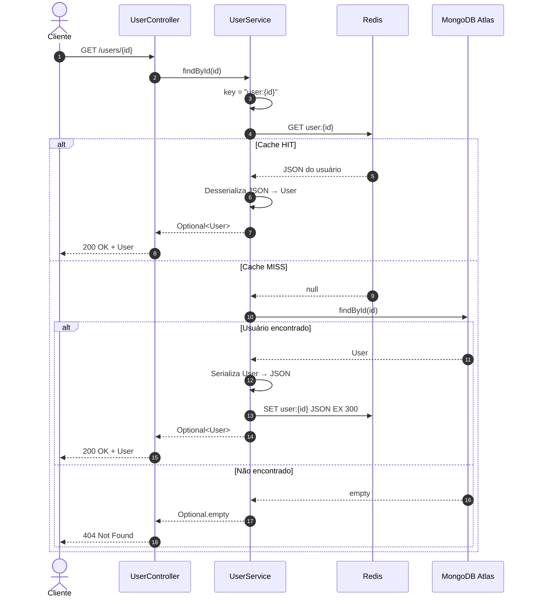
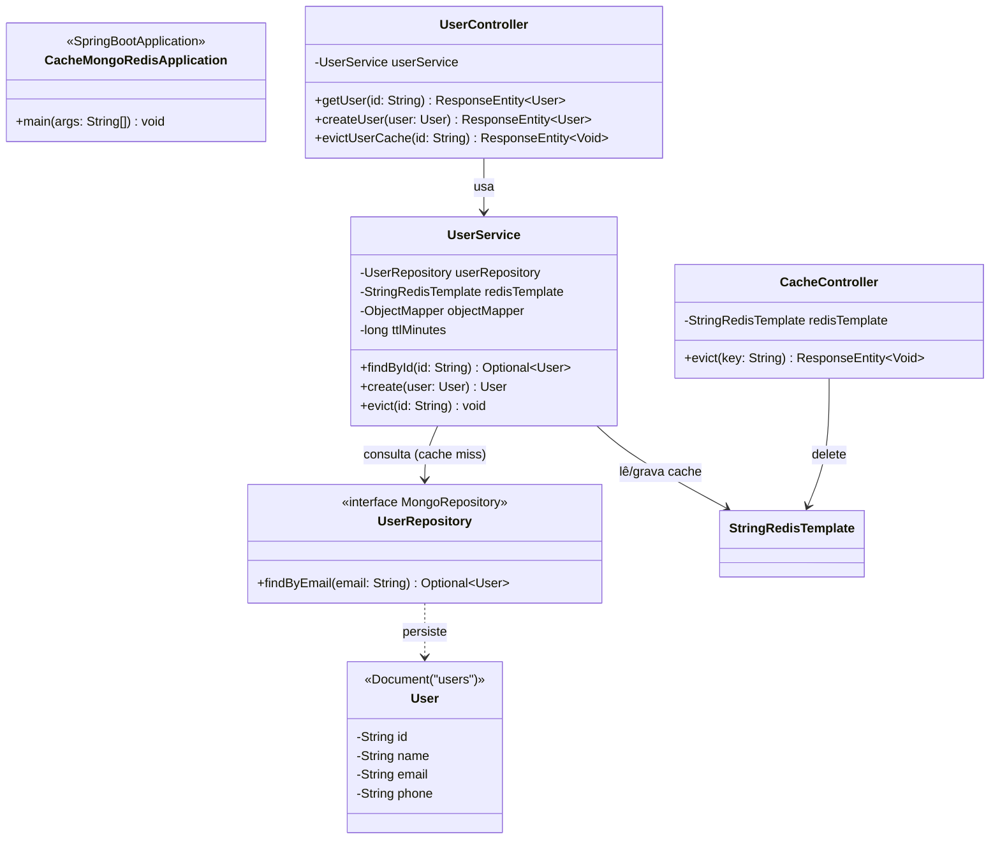
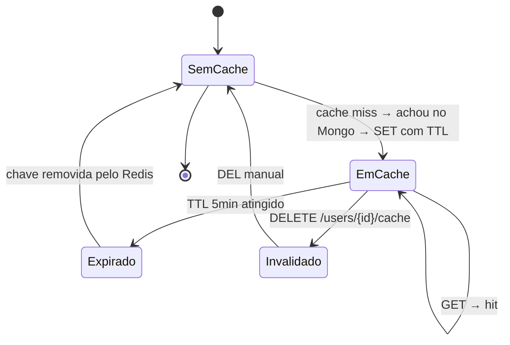

# cache-mongo-redis

Microserviço Spring Boot que implementa o padrão **cache-aside**: consulta o Redis primeiro e, em caso de *cache miss*, busca no MongoDB (Atlas) e grava o resultado no Redis com TTL.

- **Fonte da verdade:** MongoDB Atlas (collection `users`)
- **Cache:** Redis 7 (rodando como Deployment no OpenShift)
- **Deploy:** Red Hat OpenShift Service on AWS (ROS A) via GitHub Actions

## Stack

- Java 21 + Spring Boot 3.4
- Spring Data MongoDB, Spring Data Redis, Spring Actuator
- Docker + OpenShift (Deployment, Service, Route, PVC)
- GitHub Actions (CI/CD)

## Endpoints

| Método | Rota | Descrição |
|---|---|---|
| `GET` | `/users/{id}` | Busca usuário: Redis → MongoDB → grava no Redis (TTL 5min) |
| `POST` | `/users` | Cria usuário no MongoDB (body: `name`, `email`, `phone`) |
| `DELETE` | `/users/{id}/cache` | Invalida o cache de um usuário (`user:{id}`) |
| `DELETE` | `/cache/{key}` | Invalida qualquer chave do Redis |
| `GET` | `/actuator/health` | Health check (usado pelos probes do OpenShift) |

### Exemplos

```bash
# Criar usuário
curl -X POST https://<host>/users \
  -H "Content-Type: application/json" \
  -d '{"name":"Anderson","email":"ander@teste.com","phone":"11999999999"}'

# Buscar (1ª vez: cache miss → Mongo; 2ª vez: cache hit → Redis)
curl https://<host>/users/<id>

# Invalidar cache
curl -X DELETE https://<host>/users/<id>/cache
curl -X DELETE https://<host>/cache/user:<id>
```

## Como funciona

### Diagrama de sequência — consulta



### Diagrama de classes



### Diagrama de estados — ciclo de vida da chave no Redis



### Decisões de design

| Aspecto | Comportamento |
|---|---|
| Fonte da verdade | MongoDB — o Redis é descartável |
| Cache key | `user:{id}` |
| Valor no Redis | JSON serializado do documento |
| TTL | 5 min (`CACHE_TTL_MINUTES`) |
| JSON corrompido | Chave deletada e rebusca no Mongo |
| 404 | Não é cacheado (evita cache de negativos) |

## Configuração

Variáveis de ambiente (ver `src/main/resources/application.yml`):

| Variável | Default | Descrição |
|---|---|---|
| `MONGODB_URI` | `mongodb://localhost:27017/userdb` | Connection string (Atlas usa `mongodb+srv://`) |
| `REDIS_HOST` | `localhost` | Host do Redis |
| `REDIS_PORT` | `6379` | Porta do Redis |
| `REDIS_PASSWORD` | vazio | Senha do Redis |
| `CACHE_TTL_MINUTES` | `5` | TTL do cache |
| `SERVER_PORT` | `8080` | Porta HTTP |

## Execução local

```bash
# 1. Subir dependências
docker run -d -p 27017:27017 mongo
docker run -d -p 6379:6379 redis

# 2. Rodar a aplicação
mvn spring-boot:run
```

## Deploy no OpenShift

Manifests em `openshift/`:

- `redis.yaml` — Deployment + PVC + Service do Redis
- `app.yaml` — Deployment + Service + Route + ConfigMap da aplicação
- `mongodb-secret.example.yaml` — modelo do Secret com o `MONGODB_URI` do Atlas

O `MONGODB_URI` fica no secret `mongodb-atlas-uri` (não comitar credenciais):

```bash
oc create secret generic mongodb-atlas-uri \
  --from-literal=uri="mongodb+srv://<user>:<pass>@<cluster>.mongodb.net/userdb" \
  -n <namespace>
```

## CI/CD (GitHub Actions)

`.github/workflows/deploy.yml` dispara em push na `main`:

1. `mvn package` (JDK 21)
2. `docker build` da imagem
3. Login no registry interno do OpenShift e push
4. `oc apply` dos manifests + `oc rollout status`

**Secrets necessários no repositório:**

| Secret | Descrição |
|---|---|
| `OC_TOKEN` | Token do ServiceAccount `github-deployer` no OpenShift |

O ServiceAccount precisa dos roles `edit`, `view` e `system:image-builder` no namespace.

## Estrutura do projeto

```
├── Dockerfile
├── pom.xml
├── openshift/
│   ├── app.yaml
│   ├── redis.yaml
│   └── mongodb-secret.example.yaml
├── .github/workflows/deploy.yml
└── src/main/java/br/com/example/cacheredis/
    ├── CacheMongoRedisApplication.java
    ├── controller/   (UserController, CacheController)
    ├── model/        (User)
    ├── repository/   (UserRepository - Mongo)
    └── service/      (UserService - cache-aside)
```
